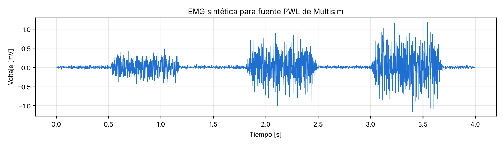

# Del músculo a la señal · Señal EMG sintética para Multisim

Material de apoyo del taller **"Del músculo a la señal: desarrollo de sensores de EMG para control de prótesis y órtesis"**, impartido en el **XLIX Congreso Nacional de Ingeniería Biomédica** (Oaxaca, octubre 2026).

Imparte: **Dra. Marysol García Pérez** · Universidad La Salle Bajío

---

## Contenido

| Archivo | Descripción |
|---|---|
| `emg_sintetica_pwl.txt` | Señal de EMG de superficie sintética, lista para cargarse en una fuente PWL de Multisim |
| `generar_emg_pwl.py` | Script de Python que genera la señal (opcional, para crear variantes) |
| `vista_previa.png` | Gráfica de la señal |



## ¿Qué contiene la señal?

- **Duración:** 4 s, muestreada a 5 kHz (20 001 puntos).
- **Formato:** dos columnas separadas por espacio: tiempo en segundos y voltaje en volts.
- **Contenido:** reposo y tres contracciones de fuerza creciente:

  | Contracción | Inicio | Fin | Fuerza relativa |
  |---|---|---|---|
  | 1 | 0.5 s | 1.2 s | 40 % |
  | 2 | 1.8 s | 2.5 s | 70 % |
  | 3 | 3.0 s | 3.7 s | 100 % |

- **Amplitud:** picos de aproximadamente ±1.2 mV, del orden de una EMG de superficie real.
- **Banda:** ruido filtrado entre 20 y 450 Hz, la banda útil de la EMG de superficie.

Es una señal **sintética**, pensada para simular el sistema de instrumentación. No proviene de un registro real.

## Descarga

En la página del archivo `emg_sintetica_pwl.txt`, usa el botón **Download raw file** (ícono de descarga, arriba a la derecha del contenido).

Si das clic en **Raw**, el navegador solo mostrará miles de números. En ese caso usa clic derecho › **Guardar como…** y conserva la extensión `.txt`.

## Cómo cargarla en Multisim

1. Ve a **Place › Component › Sources › SIGNAL_VOLTAGE_SOURCES** y coloca una **PIECEWISE_LINEAR_VOLTAGE**.
2. Haz doble clic sobre la fuente. En la pestaña **Value**, elige la opción para leer los datos desde un archivo y selecciona `emg_sintetica_pwl.txt`.
3. Conecta la fuente **entre +IN y −IN** del amplificador de instrumentación. Es la señal diferencial que verían los dos electrodos.
4. Ve a **Simulate › Interactive Simulation Settings** y ajusta:
   - **Paso máximo (Maximum time step): 0.2 ms o menor.** Así Multisim no se salta puntos del archivo.
   - **Tiempo final (TSTOP): 3.9 s.** El archivo dura 4 s; detener la simulación justo antes evita un error de convergencia al llegar al final de los datos.

### Para una simulación más realista (opcional)

Agrega dos fuentes más para imitar lo que ocurre en el cuerpo:

| Fuente | Valor | Conexión | Qué representa |
|---|---|---|---|
| `AC_VOLTAGE` | 1 V pico, 60 Hz | Entre GND y un nodo común ("CUERPO") del que salen ambos electrodos | Interferencia de la red en modo común |
| `DC_POWER` | 20 mV | En serie con uno de los electrodos | Offset de la interfaz piel-electrodo |

```
GND ─(−)[AC 60 Hz, 1 Vpk](+)─ CUERPO ─────────────────────────── IN−
                               │
                               └─(−)[PWL](+)──(−)[DC 20 mV](+)── IN+
```

El amplificador de instrumentación debe rechazar los 60 Hz, porque llegan iguales a ambas entradas, y amplificar la EMG.

### Circuito sugerido para la simulación

- Amplificador de instrumentación **AD620AN** (disponible en la base de datos de Multisim) con **RG = 240 Ω** entre los pines 1 y 8, lo que da una ganancia de ≈ 207.
- Pin 5 (REF) a GND; alimentación de ±9 V en los pines 7 y 4.
- Después: pasa altas de 20 Hz → notch de 60 Hz → pasa bajas de 500 Hz → rectificador (opcional).

### Osciloscopio

- **Entrada diferencial:** usa el osciloscopio genérico de 2 canales, que tiene terminales + y −. Conecta + a IN+ y − a IN−.
- **Salidas de cada etapa:** cualquier canal referido a GND (sirve el Tektronix de 4 canales).
- **Base de tiempo:** 500 ms/div, para ver las tres contracciones.
- **Trigger:** Auto o None. La EMG no es periódica.

## Qué deberías observar

| Punto de medición | Qué debes ver | Escala sugerida |
|---|---|---|
| Entrada diferencial | EMG de ±1 mV con tres contracciones | 500 µV/div |
| Salida del AD620 | EMG × 207 sobre ≈ 4 V de DC (el offset) | 1 V/div, DC |
| Después del pasa altas | Sin DC; ráfagas de ≈ ±0.25 V | 100 mV/div |
| Después del notch y el pasa bajas | Señal limpia, sin 60 Hz visible | 100 mV/div |
| Rectificador (opcional) | Solo semiciclos positivos | 100 mV/div |

**Experimento:** sube el offset a 100 mV. La salida del AD620 se satura (100 mV × 207 ≈ 21 V, más de lo que permite la alimentación). ¿Por qué el pasa altas debe ir justo después del amplificador de instrumentación?

## Generar tus propias variantes (opcional)

Requiere Python 3 con `numpy` y `scipy`:

```bash
pip install numpy scipy
python generar_emg_pwl.py
```

Al inicio del script puedes cambiar:

- `DURACION` y `FS`: duración y frecuencia de muestreo. Redúcelas si la simulación va lenta en tu computadora.
- `PICO_RMS`: amplitud de la señal.
- `CONTRACCIONES`: inicio, fin y fuerza de cada contracción.
- `SEMILLA`: cambia la forma aleatoria de la señal, como si fuera otra persona.

Si cambias la duración, ajusta también el TSTOP de Multisim para que sea un poco menor.

## Problemas comunes

| Problema | Solución |
|---|---|
| Multisim marca *Simulation error* al final | Pon TSTOP = 3.9 s o desactiva la repetición de datos en la fuente PWL |
| La simulación va muy lenta | Genera una versión más corta o con menor `FS` usando el script |
| La salida del amplificador queda pegada a +9 V o −9 V | Revisa que REF (pin 5) esté a GND y que el offset no sea demasiado grande para la ganancia |
| Mucho 60 Hz a la salida | Verifica que **ambos** electrodos salgan del mismo nodo CUERPO |
